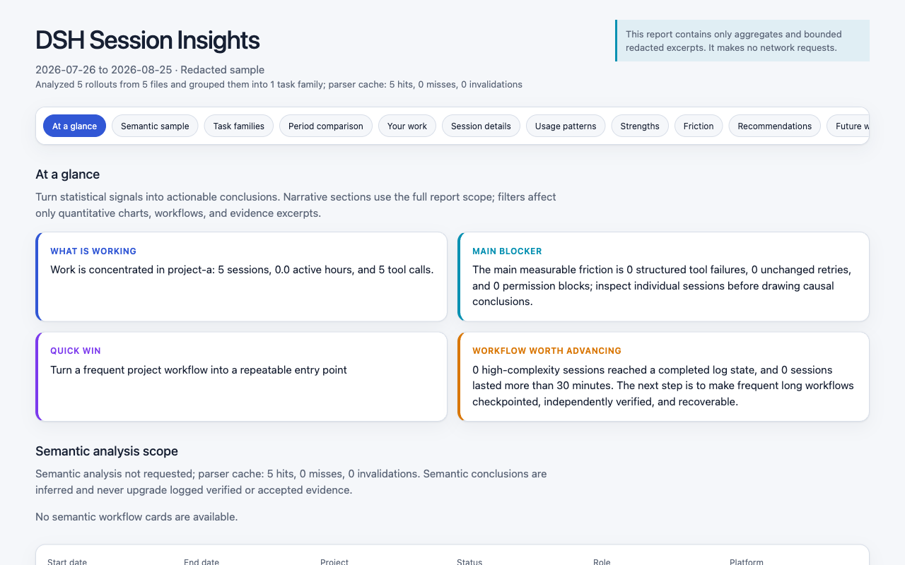
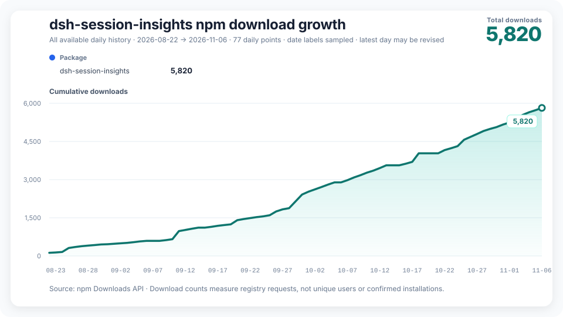

# dsh-session-insights

[简体中文](README.zh-CN.md) | [Русский](README.ru-RU.md) | [Introduction](https://greenlv.github.io/blogs/chat-log-is-not-a-retrospective/) | [Changelog](CHANGELOG.md)

[](https://github.com/GreenLv/dsh-session-insights/actions/workflows/ci.yml)
[](https://github.com/GreenLv/dsh-session-insights/releases/latest)
[](LICENSE)

Run `/session-insights` in DeepSeek Harness (DSH) to review your session history. Open the HTML report to compare where you spent time across projects, spot tool failures and retries, and find sessions worth revisiting.

## Quick start

The 0.8.1 Bundle requires DSH `>=0.2.2-rc.2` and Node.js `>=24.9.0`. The plugin runs without Python. (0.8.0 required `>=0.2.2-rc.1`; this release raises the supported floor to 0.2.2-rc.2.)

DSH rc.2 fixes the previous Zod dependency issue, but its full host dependency tree still has known advisories. Review the [security policy](SECURITY.md#known-upstream-dependency-gap) before use.

For DSH Web, run:

```bash
dsh plugin --profile web add dsh-session-insights@0.8.1
dsh web
```

In the DSH message box, run:

```text
/session-insights --days 30 --locale en --deterministic
```

Open the returned `report.html` path in your browser. The plugin writes it and `report.json` to a new directory under `$DSH_HOME/insights/runs/`. This command analyzes the selected sessions locally, without asking a model to read them.

**Desktop.** Install the same package with the official app's plugin controls. On macOS you can also use the app's bundled CLI:

```bash
"/Applications/DeepSeek Harness.app/Contents/Resources/runtime/cli/bin/dsh" plugin --profile desktop add dsh-session-insights@0.8.1
```

If a Windows reinstall fails with `EPERM` because files are in use, close Desktop and its child host before retrying. Then run the same slash command and open the returned HTML file.

## Read the report

<p align="center"></p>

- Compare sessions, active time and token usage across two periods. Token totals describe recorded usage, rather than a bill.
- See which projects and workflows account for the most activity. Follow the evidence to sessions with failures, retries or unfinished work.
- Review when you work and which tools, skills and plugins you use. With model analysis enabled, the report can also suggest changes to your workflow and give you prompts to try.

The HTML includes its data and styles and works offline. The companion JSON follows the [report schema](docs/schema/report-v1.schema.json). Interpret inferred patterns alongside their evidence, especially when judging whether work was completed.

## Choose what to share

Remove `--deterministic` to have the current DSH agent review selected session evidence and write findings. It works through batches one at a time. Wait for the final report path after the command says the run was queued.

With model analysis, your configured provider receives selected excerpts. Its data handling and charges apply. Redaction reduces exposure, but sensitive text can still appear in excerpts.

| `--privacy` | What the report keeps |
| --- | --- |
| `redacted` (default) | Selected excerpts with identities, paths and likely secrets filtered |
| `metrics` | Aggregate measurements only. Model analysis is skipped. |
| `local` | Selected text and local paths after secret filtering. Use `--deterministic` to keep the analysis on this machine. |

Model analysis uses the report’s privacy mode unless you set `--analysis-privacy` separately. Either privacy option set to `metrics` skips that stage. See the [security policy](SECURITY.md) for what the plugin reads, writes and sends.

## Select, resume or remove a run

```text
/session-insights [--days N] [--project PATH] [--locale zh-CN|en|ru]
  [--privacy MODE] [--analysis-privacy MODE] [--analysis-depth conversation|evidence]
  [--report-timezone ZONE] [--deterministic] [--resume] [--workdir RUN] [--no-open]
```

- Use `--project` with an absolute path, for example `/path/to/project` or `C:/path/to/project` on Windows. Quote paths containing spaces. If the selection exceeds 2,000 sessions or 64 MiB of input, shorten the time window or select one project.
- Dates and hours use the host timezone by default. Set `--report-timezone Asia/Shanghai` or `--report-timezone UTC+08:00` to choose another.
- Resume model analysis with `--resume --workdir RUN` and the same days, project, locale, timezone, depth and privacy settings. If more than one run matches, use the reported directory to choose. When model output remains invalid after one repair attempt, the workflow can keep a local report marked as a fallback.
- For a report generated directly by the command, `--no-open` returns just the file path. Open the HTML yourself when you want to view it.

Run directories hold the report and its evidence until you remove them. Type `/session-insights --cleanup RUN` to preview one run, then add `--confirm` to delete that run and its reports. The plugin only removes directories it marked as its own. If the agent requests cleanup through its tool, the host must ask you to approve it.

## DSH compatibility

Version 0.8.1 targets DSH `0.2.2-rc.2` as its exact acceptance host; rc.1 and older hosts are refused. The source and contract checks for this candidate run against that exact host, while native, GUI and model acceptance are completed per platform before release. Historical releases were tested against their own hosts: the [0.8.0 release notes](docs/releases/v0.8.0.md) record the rc.1 testing of that published version.

If you upgrade to 0.8.1 while model analysis is in progress, finish it with the version that created the run or start a new one after upgrading: the analysis identity changed with the rc.2 retarget, so 0.8.0 runs do not resume under 0.8.1. Existing reports can still be opened. The standalone CLI rebuilds old report caches automatically and needs its own update.

For a source installation, clone this repository and check out the release tag (for example `v0.8.1`) before running `dsh plugin --profile web add .` from that checkout. This selects the published version's source.

## Standalone Python CLI and Skill

Use the standalone CLI to read on-disk V4 session logs or generate reports from a script. It requires Python 3.11 or later. Run the installer from the version of this repository you want to use.

On macOS or Linux:

```bash
DSH_HOME="${DSH_HOME:-$HOME/.dsh}"
python3 scripts/bootstrap.py install --dsh-home "$DSH_HOME"
CLI="$DSH_HOME/tools/dsh-session-insights/venv/bin/dsh-session-insights"
"$CLI" report --dsh-home "$DSH_HOME" --days 30 --locale en --format html --output ./dsh-insights.html
```

On Windows, in PowerShell:

```powershell
if (-not $env:DSH_HOME) { $env:DSH_HOME = Join-Path $HOME '.dsh' }
python scripts/bootstrap.py install --dsh-home $env:DSH_HOME
$Cli = Join-Path $env:DSH_HOME 'tools\dsh-session-insights\venv\Scripts\dsh-session-insights.exe'
& $Cli report --dsh-home $env:DSH_HOME --days 30 --locale en --format html --output .\dsh-insights.html
```

Open the resulting `dsh-insights.html`, or add `--open` to the CLI report command to open it automatically. Use `doctor --dsh-home <path>` to check the installation, `report --help` for other formats and filters, and `semantic --help` for scripted model review. Run `scripts/bootstrap.py uninstall` with the same Python and DSH home to remove the managed CLI and Skill.

The CLI reads `session.v4.jsonl` or `session.v4.jsonl.zstd`. Migrate older logs in DSH first. When the latest log cannot be read, the CLI reports the problem rather than counting an older copy of the same session.

## Project links

- [npm package](https://www.npmjs.com/package/dsh-session-insights) · [GitHub releases](https://github.com/GreenLv/dsh-session-insights/releases/latest) · [dsh.pub listing](https://dsh.pub/en/plugins/dsh-session-insights/)
- [Changelog](CHANGELOG.md) · [Contributing](CONTRIBUTING.md) · [Distribution record](docs/distribution.md)



The chart counts npm download requests, which can include repeated downloads and automation.

[MIT License](LICENSE)
