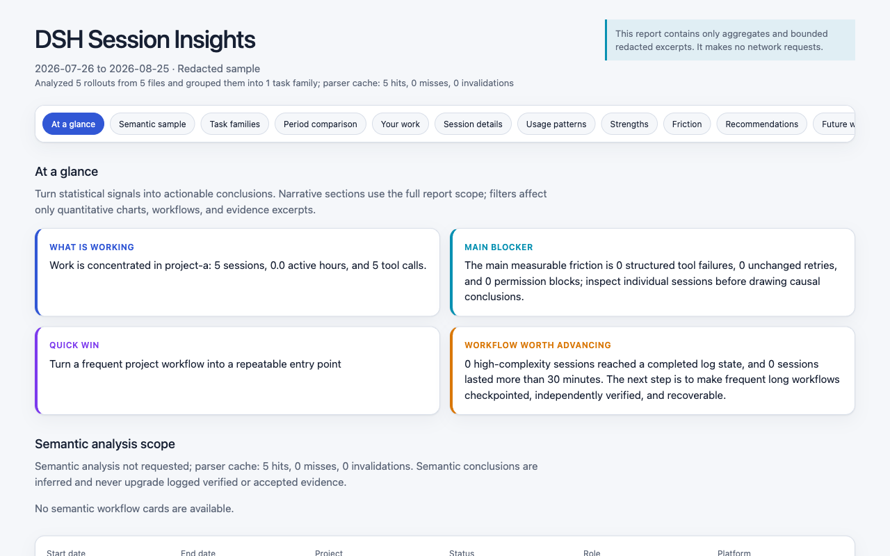
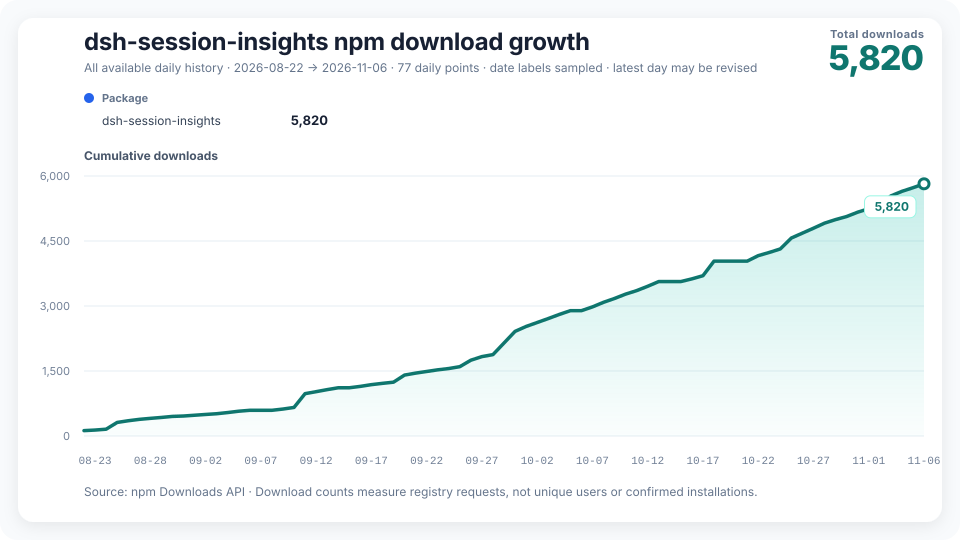

# dsh-session-insights

[English](README.md) | [简体中文](README.zh-CN.md) | [Введение](https://greenlv.github.io/blogs/chat-log-is-not-a-retrospective/) | [Журнал изменений](CHANGELOG.md)

[](https://github.com/GreenLv/dsh-session-insights/actions/workflows/ci.yml)
[](https://github.com/GreenLv/dsh-session-insights/releases/latest)
[](LICENSE)

Команда `/session-insights` превращает историю сессий DeepSeek Harness в локальный обзор рабочих процессов. Бандл читает сессии через службу `sessionQuery` DSH и записывает самодостаточный HTML-дашборд вместе с сопутствующим JSON.

Он помогает ответить на вопросы:

- Какую работу я выполняю с помощью DSH?
- Какие проекты и процессы требуют больше всего усилий?
- Где появляются сбои инструментов, повторные попытки или незавершённая работа?
- Какие практики работают, и что стоит попробовать дальше?

Это **поведенческий обзор, а не телеметрия**. Он не является живым монитором, калькулятором стоимости и не утверждает, что может судить о качестве вашей работы.


## Что вы получаете

Дашборд объединяет несколько представлений одних и тех же свидетельств:

| Представление | Что оно помогает понять |
|---|---|
| Обзор и сравнение периодов | Сессии, семейства задач, использование токенов и изменения между двумя периодами |
| Разбивка по работе и процессам | Проекты, роли, показательные процессы и свидетельства завершения |
| Паттерны использования | Ежедневная динамика активного времени, типы сессий, популярные инструменты, использование Skills и plugin/MCP, типы файлов и локальные активные часы |
| Успехи и затруднения | Подкреплённые свидетельствами сильные стороны, а также сбои, повторы и другие сигналы, которые стоит исследовать |
| Рекомендации | Предложения по процессам DSH, привязанные к измеренным свидетельствам, с готовыми к копированию промптами |

<p align="center"></p>

HTML-файл содержит собственные стили и данные, поэтому его можно хранить локально и открывать без сервера. Рядом записывается машиночитаемый JSON-отчёт.

## Установка бандла

Бандл `0.7.0` поставляется с тремя локалями — `zh-CN`, `en` и русской (`--locale ru`) — и полной [`README.ru-RU.md`](README.ru-RU.md).

Бандл `0.7.0` требует DSH `>=0.2.1-rc.2` и Node.js `^22.19.0 || >=24.0.0`, без Python. Необязательный CLI для файловых логов по-прежнему требует Python 3.11+. Запуски, созданные в 0.6.1, сохраняют записанную область и остаются возобновляемыми; старые детерминированные кэши игнорируются автоматически.

**Совместимость с DSH:** пакет требует `>=0.2.1-rc.2` — `0.2.1-rc.5` является основным хостом, на котором проходило приёмочное тестирование этого релиза, а `0.2.1-rc.2` сохраняет покрытие совместимости. DSH `0.2.0-rc.2` и `0.2.1-rc.1` ниже поддерживаемого минимума; более поздние релизы допускаются по объявленному диапазону, а не по статическим таблицам версий: будущая версия хоста внутри диапазона допускается, но ещё не тестировалась. Контрактные и сервисные тесты покрывают синтетический ввод V4. Результаты нативных, модельных и UI-проверок фиксируются отдельно в приёмочных отчётах, приложенных к каждому конкретному релизному артефакту; допуск по диапазону не означает, что будущие хосты протестированы. См. [Совместимость с DSH](#совместимость-с-dsh).

**Известный пробел в безопасности вышестоящей зависимости:** шесть официальных пакетов DSH вплоть до rc.5 закрепляют уязвимый `zod@4.4.3` (GHSA-mrhx-c7xc-m3w5 / CVE-2023-54404). Исключение для 0.6.1 истекло вместе с набором зависимостей того выпуска и не продлено. 2026-11-03 сопровождающий принял новое ограниченное решение о риске для проверенного набора 0.7.0. Уязвимость остаётся неисправленной; достижимый путь в DSH и вероятность срабатывания при обычном использовании не установлены. Принятие риска не означает готовности к выпуску; состояние артефакта и проверок выпуска указано в [записи о приёмке кандидата](docs/acceptance/v0.7.0-candidate.md). Перед установкой прочитайте [описание риска и статус решения](SECURITY.md#known-upstream-dependency-gap).

Команда установки из реестра ниже требует, чтобы `0.7.0` была опубликована. При тестировании кандидата устанавливайте вместо неё проверенный tarball или ревизию исходников. Перед использованием команды реестра проверьте версию на [GitHub Releases](https://github.com/GreenLv/dsh-session-insights/releases):

```bash
dsh plugin --profile web add dsh-session-insights@0.7.0
dsh web
```

Для установки из исходников замените `REVIEWED_REF` на `v0.7.0` после публикации или на полный коммит кандидата, указанный в манифесте его артефакта. Выберите эту ревизию перед установкой: простое клонирование переключает на ветку по умолчанию, которая может содержать другую версию:

```bash
git clone https://github.com/GreenLv/dsh-session-insights.git
cd dsh-session-insights
git checkout --detach REVIEWED_REF
dsh plugin --profile web add .
dsh web
```

По умолчанию семантический анализ передаёт ограниченные данные сессий через текущего агента DSH настроенному для него провайдеру модели. Применяются правила обработки данных и тарифы этого провайдера. Фрагменты сессий могут содержать конфиденциальные сведения, а обезличивание и фильтрация секретов не гарантируют защиты от раскрытия. Добавьте `--deterministic`, чтобы пропустить анализ моделью. Батчи обрабатываются последовательно; время зависит от выбранных сессий и скорости ответа модели.

Затем выполните в поле ввода DSH:

```text
/session-insights --days 30 --locale ru
```

Команда готовит ограниченные семантические батчи, ставит текущего агента DSH в очередь на их последовательный анализ и записывает итоговые HTML/JSON в `$DSH_HOME/insights/runs/<run-id>`. Добавьте `--deterministic`, чтобы пропустить этап с участием модели. Имя команды намеренно отличается от `/insights`, поэтому бандл может сосуществовать с `dsh-insights`.

Пакет npm не имеет install- или build-скриптов жизненного цикла. Команда реестра устанавливает опубликованный бандл; `dsh plugin ... add .` устанавливает текущую локальную копию.

### Официальный Desktop

Desktop использует ту же реализацию анализа на Node. Его профиль плагинов управляется официальным приложением Electron; npm CLI отклоняет `--profile desktop`. Используйте элементы управления плагинами приложения или встроенный носитель команд. В macOS этот носитель — `/Applications/DeepSeek Harness.app/Contents/Resources/runtime/cli/bin/dsh`; вызывайте его с `plugin --profile desktop add <package>`. Результаты для конкретных платформ смотрите в приёмочных отчётах, приложенных к точному релизному артефакту. В Windows перед переустановкой закройте основное приложение и его дочерний хост, если файлы заняты (`EPERM`). Для просмотра отчёта используется HTML-путь, возвращённый командой; откройте его в локальном браузере или передайте `--no-open`, чтобы получить путь без подсказки о просмотре.

## Доступность

- Установите опубликованный бандл из [npm](https://www.npmjs.com/package/dsh-session-insights).
- Скачайте версионированные артефакты с [GitHub Releases](https://github.com/GreenLv/dsh-session-insights/releases/latest).
- Найдите публичную запись в каталоге на [dsh.pub](https://dsh.pub/en/plugins/dsh-session-insights/).
- Другие проверенные записи сообщества перечислены в [реестре распространения](docs/distribution.md).

## Разрешения и зависимости

Бандл анализирует снимки `sessionQuery` в worker-процессе Node.js. Он не запускает Python или оболочку, а worker получает пустое окружение и не наследует аргументы запуска Node. `DSH_SESSION_INSIGHTS_PYTHON`, `PYTHONPATH` и файлы запуска Python больше не влияют на нативный анализ. Необязательный Python CLI остаётся отдельным процессом.

| Возможность | Область действия |
|---|---|
| Сессии и файлы | Читает выбранные снимки в памяти. Записывает отчёты, ограниченные свидетельства и проверенные выходные данные модели в помеченные каталоги под `$DSH_HOME/insights/runs`. Не сохраняет сырые снимки и не создаёт общий семантический кэш. |
| Защита путей | Требуется прямой помеченный каталог запуска; проверяется каждый путь артефакта, ссылки и специальные файлы отклоняются. ID батчей должны принадлежать манифесту запуска. Новые каталоги и файлы получают POSIX-права только для владельца; в Windows доступ наследуется от ACL родителя. |
| Окружение и учётные данные | Хост использует `DSH_HOME` или домашний каталог ОС для поиска хранилища. Нативный анализ не ищет интерпретаторы, не передаёт окружение, не использует отдельный API-ключ или хранилище учётных данных. Содержимое сессий всё ещё может содержать секреты; редактирование не является гарантией неразглашения. |
| Сеть и модели | Детерминированный анализ работает офлайн. Семантический процесс по умолчанию отправляет ограниченные обезличенные свидетельства через текущего агента DSH в настроенный провайдер модели, с его правилами обработки данных и расходами. Используйте `--deterministic`, чтобы пропустить его. |

Бандл требует Node.js `^22.19.0 || >=24.0.0` и службы DSH `commands`, `tools` и `sessionQuery`. Бандл использует объявленные peer-зависимости DSH `>=0.2.1-rc.2`, включая официальный помощник сообщений. Отсутствующие службы, сбой worker, небезопасные пути или некорректный семантический вывод останавливают затронутую операцию. Вывод модели проверяется перед записью; отклонённая замена сохраняет предыдущий корректный результат. Явный откат создаёт детерминированный отчёт с пометкой о деградации.

Один запуск принимает не более 2 000 выбранных снимков и 64 MiB сериализованного ввода снимков. При превышении уменьшите `--days` или отфильтруйте по `--project`. В экземпляре плагина одновременно собираются и анализируются не более двух запусков, остальные запросы ждут в очереди с возможностью отмены, поэтому одновременные вызовы slash-команды и инструмента не могут неограниченно размножать worker-процессы; лимит `maxOldGenerationSizeMb` для одного worker ограничивает только V8 old space этого worker и не является гарантией RSS хоста. Нативные запуски записывают полную область выбора (нормализованный проект, длину окна, пару приватности, глубину и локаль); возобновление привязывается к явному запуску и требует той же области, поэтому запрос на возобновление никогда не выберет другой проект или более широкий диапазон приватности. Запуски, манифест которых не содержит записанной области или чьи формат либо семантика анализатора отличаются, отклоняются; рост версии хоста сам по себе не делает семантически идентичный запуск недействительным. Нативные запуски сохраняют собственные проверенные результаты для возобновления, но не используют общий семантический кэш между запусками.

### Хранение и очистка

Отчёты и свидетельства остаются на диске до явного удаления. `session_insights_cleanup` с `workdir` запуска — это предварительный просмотр файлов и байтов без изменений. Удаление требует одобрения человека в хосте: при `confirm: true` инструмент один раз запрашивает у службы одобрения развёртывания разрешение ровно для этого запуска, и удаляет что-либо только при предоставлении `allowed-once` (ответ на запрос, который видит пользователь); флаг, переданный моделью, сам по себе никогда не разрешает удаление, а хосты без службы одобрения отказывают. Ввод команды DSH `/session-insights --cleanup <run>` показывает предварительный просмотр, а `/session-insights --cleanup <run> --confirm` удаляет ровно один именованный запуск — команда не выполняет анализ и не ставит задачи модели в очередь, выступая прямым человеческим входом. Очистка удаляет весь помеченный запуск, включая его отчёт, и не может быть отменена. Она отклоняет непомеченные устаревшие каталоги и связанные элементы (ссылки). Остальные запуски, исходные логи и общие кэши необязательного CLI сохраняются. Просмотрите старые артефакты CLI отдельно перед их удалением; подкоманда `dsh-session-insights cache` показывает предварительный просмотр и (с `--delete`) удаляет только подтверждённые корни кэша.

Необязательный CLI по-прежнему требует Python 3.11+ и `zstandard>=0.23,<1` для сжатых логов; `jsonschema>=4.23,<5` и `tzdata>=2024.1` используются только в тестах разработки. Его bootstrap-установщик запускает pip и управляет собственными каталогами skill/runtime. Отдельные границы и ограничения политики STORE см. в [Политике безопасности](SECURITY.md).

## Режимы приватности

Детерминированные отчёты работают офлайн. В нативном режиме полные сырые снимки анализируются в памяти и не копируются в каталог запуска. Выберите, сколько содержимого сессий могут сохранять отчёт и необязательный этап модели:

| Режим | Содержимое отчёта | Семантический анализ |
|---|---|---|
| `redacted` (по умолчанию) | Сохраняет ограниченные фрагменты после обезличивания идентификаторов и путей и фильтрации секретов | Использует ограниченные обезличенные свидетельства в семантическом процессе по умолчанию; `--deterministic` пропускает его |
| `metrics` | Исключает фрагменты и сохраняет агрегированные измерения | Отключён; семантические батчи не создаются |
| `local` | Сохраняет ограниченные локальные пути и текст после фильтрации секретов | Явное согласие для доверенного локального получателя и настроенного провайдера модели |

Сам инструмент не добавляет канал загрузки. Если вы используете необязательный семантический процесс, ограниченные свидетельства, очищенные согласно `--analysis-privacy`, анализируются провайдером модели, настроенным в DSH.

Отчёты запрещено создавать внутри `$DSH_HOME/sessions`, поэтому сгенерированные файлы не могут смешаться с исходным деревом логов.

## Нативная команда

```text
/session-insights [--days N] [--project PATH] [--privacy MODE] [--report-timezone ZONE]
  [--analysis-privacy MODE] [--analysis-depth LEVEL]
  [--locale zh-CN|en|ru] [--deterministic] [--resume] [--workdir RUN] [--no-open]
```

Фильтры проектов используют абсолютные пути хоста. Относительный путь отклоняется с понятной ошибкой — точка входа плагина не может надёжно определить каталог вызова на хосте и отказывается угадывать. В Windows передавайте нативный путь, например `/session-insights --project C:/path/to/project`; путь с POSIX-корнем вроде `/path/to/project` отклоняется вместо молчаливого поиска без совпадений. Необязательный Python CLI разрешает относительный `--project` относительно рабочего каталога, из которого вы его вызвали.

Поля даты, часа и дня недели используют один часовой пояс отчёта, взятый у хоста во время запроса или заданный явно через `--report-timezone` (имя IANA вроде `Asia/Shanghai` или фиксированное смещение вроде `UTC+08:00`). Пояс передаётся с запросом в анализ, записывается в отчёт и манифест запуска, а сырые метки времени остаются мгновениями UTC. Необязательный Python CLI в Windows без данных IANA сообщает понятную ошибку установки tzdata вместо молчаливого отката к UTC.

Семантический процесс используется по умолчанию. Некорректный вывод модели получает одну попытку исправления и затем может явно откатиться к детерминированному отчёту. Текущая сессия учитывается в покрытии, но исключается из рекомендаций как метаанализ.

`--no-open` — это явное указание, что команда должна только сообщить путь к артефакту: вывод остаётся одной строкой пути без подсказки о просмотре, файл не открывается, сервер не запускается и ничего не загружается. Без него вывод команды добавляет одну подсказку с именем файла отчёта. Плагин сам никогда не открывает файлы, не запускает просмотрщики и не обслуживает HTTP; в Web runtime и официальном Desktop открывайте указанный HTML-путь локальным браузером или системным просмотрщиком — файл самодостаточен и работает офлайн. Поток `--resume` принимает явный каталог запуска `--workdir`; без него возобновляемый запуск выбирается только при точном совпадении записанной области с запросом, а неоднозначность между несколькими подходящими запусками сообщается с их путями вместо угадывания.

## Совместимый CLI и процесс Skill

CLI для файловых логов V4 и Skill остаются доступны для автоматизации и сред, где бандл не установлен:

```bash
DSH_HOME="${DSH_HOME:-$HOME/.dsh}"
python3 scripts/bootstrap.py install --dsh-home "$DSH_HOME"
CLI="$DSH_HOME/tools/dsh-session-insights/venv/bin/dsh-session-insights"

# Обзор последних 30 дней и открытие русского дашборда
"$CLI" report --dsh-home "$DSH_HOME" --days 30 --locale ru \
  --format html --output ./dsh-insights.html --open

# Ограничить отчёт одним проектом в macOS или Linux
"$CLI" report --dsh-home "$DSH_HOME" \
  --project /path/to/project --format html --output ./project-insights.html

# Получить агрегированные метрики без фрагментов и семантических батчей
"$CLI" report --dsh-home "$DSH_HOME" --privacy metrics \
  --format json --output ./dsh-metrics.json

# Проверить установку
"$CLI" doctor --dsh-home "$DSH_HOME"
```

Эквивалент для Windows PowerShell использует управляемый лаунчер Windows и нативный путь Windows:

```powershell
$Cli = Join-Path $env:DSH_HOME 'tools\dsh-session-insights\venv\Scripts\dsh-session-insights.exe'
& $Cli report --dsh-home $env:DSH_HOME --project 'C:\path\to\project' --format html --output .\project-insights.html
```

Чтобы удалить только управляемые каталоги этого проекта:

```bash
python3 scripts/bootstrap.py uninstall --dsh-home "$DSH_HOME"
```

Установщик управляет только:

- `$DSH_HOME/skills/dsh-session-insights`
- `$DSH_HOME/tools/dsh-session-insights`

Он отклоняет цели-символические ссылки, пересекающиеся корни и существующие непомеченные каталоги. Он не перезаписывает другой Skill.

## Ручной семантический обзор

Нативная команда по умолчанию организует семантический обзор. CLI предоставляет каждую фазу для отладки или автоматизации:

```bash
dsh-session-insights semantic prepare --dsh-home "$DSH_HOME" --days 30 --workdir /safe/workdir
dsh-session-insights semantic validate-batch --workdir /safe/workdir --batch batch-001
dsh-session-insights semantic prepare-aggregate --workdir /safe/workdir
dsh-session-insights semantic validate-aggregate --workdir /safe/workdir
dsh-session-insights semantic finalize --workdir /safe/workdir --output report.html
```

Каждый JSON-файл, созданный моделью, проверяется перед попаданием в итоговый отчёт. Неизвестные ID свидетельств, запрещённые заявления о завершении, некорректные перечисления и утечка приватности приводят к отказу; ответ агрегата также должен повторять канонический `aggregate_input_identity`, выданный `get_aggregate`, а объекты, похожие на идентификатор, в любом другом месте ответа считаются обычным содержимым. Если семантический этап не может завершиться, `finalize --fallback` фиксирует деградацию и сохраняет детерминированный отчёт.

## Текущая область и ограничения

- Нативный ввод — доверенная служба DSH `sessionQuery`; CLI читает только `session.v4.jsonl.zstd` или `session.v4.jsonl` под `$DSH_HOME/sessions`. Старые сырые логи требуют миграции вышестоящим DSH.
- Вывод соответствует [`dsh-session-insights/1`](docs/schema/report-v1.schema.json).
- Количество токенов дедуплицируется по `(turn, step)` и является измерением использования, а не основанием для выставления счетов или квоты.
- Дашборд и контракт семантических промптов поддерживают `zh-CN`, `en` и `ru` на основе одной схемы отчёта.
- Отчёты выводят закономерности из доступных свидетельств; они не доказывают намерения, качество, приёмку задачи или безопасность.

Исторические свидетельства о пакете 0.2.0, CI, нативной macOS и отдельных нативных проверках Windows сохранены в [приёмочной записи релиза v0.2.0](docs/acceptance/v0.2.0-candidate.md). Эти исторические результаты не описывают текущий релиз. Исторические свидетельства CLI/Skill v0.1 остаются в [приёмочной записи v0.1.0](docs/acceptance/v0.1.0-candidate.md). Исторические свидетельства совместимости с выпущенным runtime и его платформенные ограничения записаны в [приёмочной записи 0.1.5-rc.2](docs/acceptance/v0.1.5-rc.2-compatibility.md).

## Совместимость с DSH

Минимальная поддерживаемая версия хоста фиксируется отдельно от фактически протестированных версий. Объявленный диапазон допускает релизы DSH начиная с 0.2.1-rc.2, включая более поздние предварительные версии. Проверки формата ввода и API по-прежнему отклоняют несовместимые операции; допуск не является свидетельством того, что будущий хост протестирован.

Эта версия требует DSH `>=0.2.1-rc.2` и отклоняет более старые хосты; ввод остаётся V4 (хост 0.2.1 расширяет словарь V4, не меняя номер формата; то же верно и для rc.5). Нативный анализ использует восстановленные хостом снимки V4; необязательный Python CLI читает только `session.v4.jsonl` и `session.v4.jsonl.zstd`. Перед использованием CLI перенесите старые сырые логи вышестоящим DSH. Он никогда не откатывается к более старому поколению, если текущий файл повреждён или новее V4.

Запуски, созданные в 0.6.1, остаются возобновляемыми: идентификация ввода и семантическая схема не изменились. Детерминированные кэши CLI более ранних версий игнорируются автоматически, и запуски заново разбирают источник. Существующие отчёты HTML, JSON и Markdown сохраняются. Обновляйте отдельно установленный CLI/Skill из этой же версии; установка бандла его не обновляет.

Рабочая нагрузка инструментов включает записанные внутренние вызовы программируемого вызова инструментов (PTC). Поля JSON `tool_execution` разделяют внешние транспортные вызовы, внутренние выполнения, сбои и незавершённые внутренние вызовы; каждый записанный результат неудачного вызова учитывается один раз. Если завершаются сбоем и внутренний вызов, и его внешняя программа, оба результата остаются видимыми; отчёт не делает выводов об их общей первопричине. Отказы в доступе отличаются от неудачных команд проверки. Сообщения разработчика о регистрации инструментов и запланированные инъекции не считаются человеческими запросами.

DSH записывает запланированные промпты как сообщения с ролью пользователя и источником `schedule`, а DSH 0.2.0-rc.2 добавил асинхронные ответы на вопросы с источником `user-question-reply`. Ни те, ни другие не считаются работой пользователя: они учитываются отдельно как внедрённый контекст, исключаются из свидетельств разговора, исправлений, сигналов приёмки и вывода о завершении и никогда не могут разрешить действие. Только человеческие сообщения пользователя с источником `user` дают содержательные свидетельства. Официальные результаты восстановления со структурированными кодами ошибок `TOOL_OUTCOME_UNKNOWN` и `TOOL_NOT_STARTED` классифицируются отдельно от подтверждённых сбоев: `tool_recovery` считает `{outcome_unknown, not_started}` по сессии и в итогах. `TOOL_OUTCOME_UNKNOWN` означает, что завершённый результат записанного вызова не был надёжно записан, поэтому инструмент мог произвести побочные эффекты; `TOOL_NOT_STARTED` означает, что в журнале нет записи о начале вызова. Ни одно из состояний не считается сбоем инструмента или неудачной проверкой и не доказывает, что инструмент выполнился или ничего не сделал. Текст, который лишь упоминает код восстановления, классифицируется по обычным правилам результата. Перед повторной попыткой операции, способной изменить данные, проверьте внешнее состояние.

DSH 0.2.1-rc.2 сохраняет формат сессии 4, но добавляет обязательные записи `job/registered`, `job/settled` и `working-directory/change`. Читатель принимает их и рассматривает settlement-запись только как результат производителя/реестра: она никогда не доказывает завершение пользовательской задачи, доставку вывода или освобождение ресурсов. Задание, зарегистрированное без settlement-записи, отображается как незавершённое (в том числе когда родительский ход завершился во время его выполнения); потерянная регистрация считается аномалией целостности, а не делает сессию нечитаемой. Снимки состава команды и задач, а также входящие релеи считаются свидетельствами делегирования, а не завершением задачи ведущего или человеческими промптами. Изменения рабочего каталога образуют размеченную траекторию, при этом неизменяемый cwd заголовка остаётся проектом происхождения сессии, используемым для фильтрации и возобновления; активность между проектами показывается явно, а сырые пути не попадают в отчёты `redacted`/`metrics`. Сторонние записи `plugin:` сохраняются только как непрозрачное покрытие типов и количества и никогда не становятся намерением пользователя, контекстом модели или свидетельством завершения. `web_search` и `web_fetch` считаются записанными вызовами инструментов; один поиск, вернувший много источников, всё равно остаётся одним вызовом. Сырые корзины токенов — записанные значения; `input_tokens` и `total_tokens` — производные суммы, и это явно отмечено.

Исходные и синтетические проверки для 0.6.0 с DSH 0.2.1-rc.2 сохранены в [docs/acceptance/v0.6.0-rc2.1-candidate.md](docs/acceptance/v0.6.0-rc2.1-candidate.md). Результаты нативных, модельных и UI-проверок фиксируются отдельно в приёмочных отчётах, приложенных к каждому конкретному релизному артефакту. Независимый обзор 0.5.2 записан в [docs/acceptance/v0.5.2-candidate.md](docs/acceptance/v0.5.2-candidate.md). Область обзора кандидата 0.5.1 записана в [docs/acceptance/v0.5.1-candidate.md](docs/acceptance/v0.5.1-candidate.md). [Приёмка релиза 0.5.0](docs/acceptance/v0.5.0-release.md) и [замороженная запись кандидата 0.5.0](docs/acceptance/v0.5.0-rc2-candidate.md) относятся только к реализации 0.5.0 и указанному в ней хосту. Исторические приёмочные записи относятся только к указанным в них реализациям.

## Поколения журналов сессий

Одна логическая сессия может содержать несколько неизменяемых поколений журнала. Читатель выбирает ровно одно, используя каноническое имя файла, а не временные метки файлов.

| Ситуация | Поведение |
| --- | --- |
| Несколько канонических поколений в одном каталоге сессии | Побеждает наибольшая версия; сессия учитывается один раз, а перенесённая сессия никогда не суммируется дважды |
| Только поколения 0–3 | Анализ отклоняется с требованием миграции; переносите вышестоящим DSH |
| Неканонические имена (временные, в верхнем регистре, с ведущим нулём, `.v0`, `session.lock`) | Никогда не выбираются; незавершённая запись не может быть принята за зафиксированное поколение |
| Новее поддерживаемого поколения | Сообщается и пропускается с предупреждением; сессия **не** отчитывается молча из более старого поколения |
| Повреждённое или нераспаковываемое текущее поколение | Сообщается как нечитаемое; читатель **не** откатывается к более старому поколению |
| Оба варианта сжатия в одном каталоге | Сообщается как неоднозначность; сессия не читается |
| Несколько каталогов проектов претендуют на один id сессии | Каждый каталог сессии учитывается независимо |

Подсчёт инструментов и использования сохраняет исторические события, а семантические свидетельства исключают заменённые сообщения. DSH выводит упорядоченный видимый модели разговор (surface) из своего журнала событий. Конечные точки замены ссылаются на позиции в этом разговоре, а не на числовой диапазон номеров последовательности событий.

| Событие | Поведение |
| --- | --- |
| `system/message` | Учитывается как системное содержимое; никогда не работа пользователя, не выносится во фрагменты, не попадает в заголовки или семантические свидетельства |
| `user/message` с `source.kind == "user"` | Прямой человеческий промпт: считается работой пользователя и может задать заголовок |
| `user/message` с любым другим `source.kind` | Синтетический внедрённый контекст (плагин, цель, каталог Skills, отчёт субагента, …): учитывается отдельно, исключается из работы пользователя и семантических свидетельств |
| `assistant/attempt` | Учитывается как попытка, не создавшая видимого ответа; никогда не материализуется как сообщение ассистента, а использование токенов сообщается как недоступное, а не оценивается |
| `assistant/message` | Несёт использование своего шага; использование дедуплицируется по `(turn, step)`, поэтому поле потока не может посчитать дважды |
| `surfaceOp: "append"` | Обычный рост surface |
| `surfaceOp: {op: "replace", startSeq, endSeq}` | Сжатый разговор покидает семантическое резюме; историческая статистика событий инструментов и токенов сохраняется |
| `session/end-seed` с `data.inherited: true` | Записывает точку ветвления; маркеры без тега ничего не устанавливают |
| Неизвестный тип события | Обязательные события отклоняются; для явно игнорируемых расширений сохраняется диагностика покрытия |

## История загрузок npm



Совокупный график генерируется ежедневно из npm Downloads API. Счётчики загрузок npm измеряют запросы к реестру; это не количество уникальных пользователей и не подтверждённые установки. Workflow можно также запустить вручную, если GitHub задерживает или отключает запланированный запуск.

## Разработка и документация проекта

```bash
python3 -m pip install -e '.[dev]'
npm ci --ignore-scripts
# rc.2 runtime совместимости (заявленный минимум):
npm ci --prefix tests/dsh-runtime --ignore-scripts
DSH_RUNTIME="$PWD/tests/dsh-runtime" python3 -m unittest discover -s tests -v
# rc.5 основное приёмочное runtime:
npm ci --prefix tests/dsh-runtime-rc5 --ignore-scripts
DSH_RUNTIME="$PWD/tests/dsh-runtime-rc5" DSH_EXPECTED_VERSION=0.2.1-rc.5 \
  python3 -m unittest discover -s tests -v
DSH_RUNTIME="$PWD/tests/dsh-runtime-rc5" DSH_EXPECTED_VERSION=0.2.1-rc.5 npm test
python3 scripts/build_native_rules.py --check
python3 scripts/build_fixture.py --check
python3 scripts/audit_public_tree.py --root .
```

- [Журнал изменений](CHANGELOG.md)
- [Политика безопасности](SECURITY.md)
- [Участие в разработке](CONTRIBUTING.md)
- [Заметки о распространении](docs/distribution.md)

Тестовый fixture полностью синтетический и воспроизводимо сжатый.

## Лицензия

[MIT](LICENSE)
