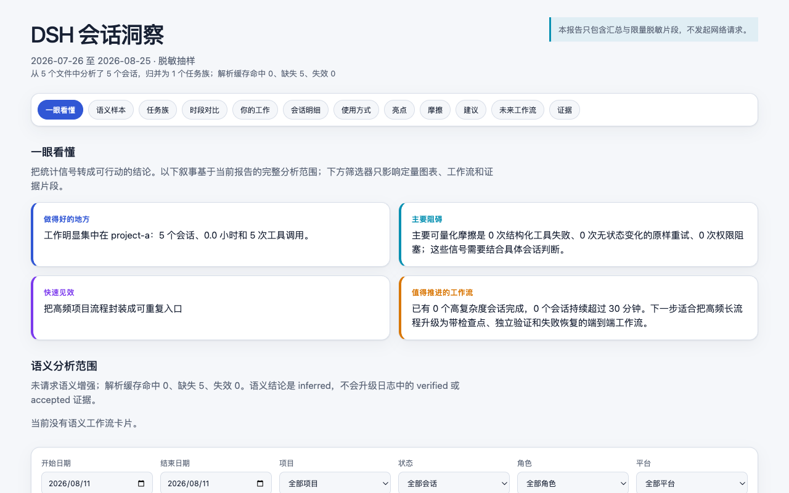
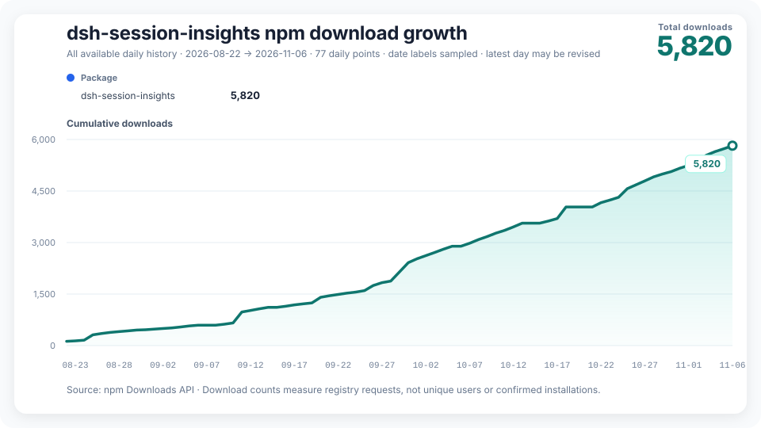

# dsh-session-insights

[English](README.md) | [Русский](README.ru-RU.md) | [介绍文章](https://blog.csdn.net/LvGreat/article/details/164067146) | [更新日志](CHANGELOG.zh-CN.md)

[](https://github.com/GreenLv/dsh-session-insights/actions/workflows/ci.yml)
[](https://github.com/GreenLv/dsh-session-insights/releases/latest)
[](LICENSE)

想回顾过去一个月用 DeepSeek Harness（DSH）做了什么，可以运行 `/session-insights`。打开生成的网页报告，就能比较各项目花了多少时间，找到工具失败、反复重试或值得回看的会话。

## 安装并生成第一份报告

0.8.1 插件包（Bundle）要求 DSH `>=0.2.2-rc.2` 和 Node.js `>=24.9.0`，安装插件无需 Python。（0.8.0 的要求是 `>=0.2.2-rc.1`；本版本把支持的宿主下限提高到 0.2.2-rc.2。）

DSH rc.2 已修复此前的 Zod 依赖问题，但完整宿主仍有已知依赖漏洞。使用前请阅读[安全说明](SECURITY.md#known-upstream-dependency-gap)。

使用 DSH Web 时，在终端执行：

```bash
dsh plugin --profile web add dsh-session-insights@0.8.1
dsh web
```

进入 DSH 后，在消息输入框运行：

```text
/session-insights --days 30 --locale zh-CN --deterministic
```

把命令返回的 `report.html` 路径放进本地浏览器打开即可。插件会在 `$DSH_HOME/insights/runs/` 下新建一个目录，保存网页报告和便于程序处理的 `report.json`。这条命令在本地整理会话记录，无需调用模型。

**官方桌面版。** 在应用的插件管理界面安装同一个包。macOS 也可以用应用自带的命令行工具：

```bash
"/Applications/DeepSeek Harness.app/Contents/Resources/runtime/cli/bin/dsh" plugin --profile desktop add dsh-session-insights@0.8.1
```

Windows 上如果重装时因文件占用报 `EPERM`，先退出桌面应用和它启动的宿主进程再试。安装后在消息框运行上面的命令，用浏览器打开报告。

## 报告里有什么

<p align="center"></p>

- 对比两个时段的会话数、活跃时间和 token 用量。用量来自会话记录，账单以服务商的数据为准。
- 按项目和工作流程查看投入，顺着报告中的证据找到失败、重试或没有收尾的会话。
- 查看常用工具、技能和插件，以及自己通常在什么时间使用 DSH。启用模型分析后，报告还可以结合会话给出改进建议和可复制的提示词。

网页内嵌了数据和样式，断网也能打开。配套 JSON 遵循[报告格式](docs/schema/report-v1.schema.json)。判断任务是否完成时，请结合报告列出的证据。

## 控制会话内容的使用范围

去掉 `--deterministic`，当前 DSH 智能体就会用模型分批分析会话片段。命令提示已排队后，等智能体给出最终报告路径。

模型会收到选中的会话片段，数据处理和费用由 DSH 中配置的模型服务商决定。脱敏会过滤常见的敏感内容，但片段仍可能含有敏感信息。

| `--privacy` | 报告保留的内容 |
| --- | --- |
| `redacted`（默认） | 过滤身份、路径和疑似密钥后的会话片段 |
| `metrics` | 只保留汇总数字，跳过模型分析 |
| `local` | 过滤疑似密钥后，保留选中的会话片段和本地路径。要把分析留在本机，请同时使用 `--deterministic`。 |

模型分析默认沿用报告的隐私设置，也可用 `--analysis-privacy` 单独指定。两个隐私选项中只要有一个设为 `metrics`，就会跳过模型分析。插件读写和发送的数据见[安全说明](SECURITY.md)。

## 筛选会话、续跑和清理

```text
/session-insights [--days N] [--project PATH] [--locale zh-CN|en|ru]
  [--privacy MODE] [--analysis-privacy MODE] [--analysis-depth conversation|evidence]
  [--report-timezone ZONE] [--deterministic] [--resume] [--workdir RUN] [--no-open]
```

- `--project` 使用绝对路径，例如 `/path/to/project` 或 Windows 上的 `C:/path/to/project`。路径包含空格时用双引号括起来。若选中超过 2,000 个会话或 64 MiB 输入，缩短时间范围或只选一个项目。
- 报告的日期和时段默认按宿主时区统计。可用 `--report-timezone Asia/Shanghai` 或 `--report-timezone UTC+08:00` 指定时区。
- 用 `--resume --workdir RUN` 继续模型分析，天数、项目、语言、时区、分析深度和隐私设置须与该次运行相同。匹配到多个运行时，按提示指定目录。模型输出修正一次后仍不合格时，流程可保留一份标记为回退结果的本地报告。
- 对于命令直接生成的报告，`--no-open` 让命令只返回文件路径。需要查看时自行打开 HTML。

报告和证据会保存在各自的运行目录。先输入 `/session-insights --cleanup RUN` 预览，再加 `--confirm` 删除这一次运行和它的报告。清理只接受插件标记过的目录。如果由智能体调用清理工具，宿主必须向你请求批准。

## DSH 兼容性

0.8.1 以 DSH `0.2.2-rc.2` 为精确验收目标；rc.1 及更早宿主会被拒绝。本候选的源码与契约检查在该精确宿主上运行，原生、GUI 和模型验收在发布前按平台单独完成。历史发布按各自宿主验证：[0.8.0 发行说明](docs/releases/v0.8.0.md)记录了该已发布版本的 rc.1 验收。

升级到 0.8.1 前，未完成的模型分析请用创建它的版本跑完，也可以在升级后重新开始：随 rc.2 目标调整，分析身份已经变化，0.8.0 的运行在 0.8.1 下不能恢复。已生成的报告可以继续打开。单独安装的命令行工具需要单独升级，旧报告缓存会自动重建。

若从源码安装，克隆本仓库后先检出发布标签（例如 `v0.8.1`），再在该目录运行 `dsh plugin --profile web add .`，以选中已发布版本的源码。

## 单独使用 Python 命令行工具和 Skill

需要直接读取磁盘上的 V4 会话日志，或用脚本批量生成报告时，可以使用单独的命令行工具。它需要 Python 3.11 或更高版本。请在要使用的仓库版本中执行安装脚本。

macOS 和 Linux：

```bash
DSH_HOME="${DSH_HOME:-$HOME/.dsh}"
python3 scripts/bootstrap.py install --dsh-home "$DSH_HOME"
CLI="$DSH_HOME/tools/dsh-session-insights/venv/bin/dsh-session-insights"
"$CLI" report --dsh-home "$DSH_HOME" --days 30 --locale zh-CN --format html --output ./dsh-insights.html
```

Windows PowerShell：

```powershell
if (-not $env:DSH_HOME) { $env:DSH_HOME = Join-Path $HOME '.dsh' }
python scripts/bootstrap.py install --dsh-home $env:DSH_HOME
$Cli = Join-Path $env:DSH_HOME 'tools\dsh-session-insights\venv\Scripts\dsh-session-insights.exe'
& $Cli report --dsh-home $env:DSH_HOME --days 30 --locale zh-CN --format html --output .\dsh-insights.html
```

打开生成的 `dsh-insights.html`，也可以在命令行的 `report` 命令后加 `--open` 自动打开。用 `doctor --dsh-home <path>` 检查安装，`report --help` 查看筛选条件和输出格式，`semantic --help` 查看如何用脚本运行模型分析。要移除脚本安装的命令行工具和 Skill，用同一个 Python 和 DSH 目录运行 `scripts/bootstrap.py uninstall`。

工具读取 `session.v4.jsonl` 或 `session.v4.jsonl.zstd`。旧日志要先在 DSH 中迁移。如果同一个会话的最新日志无法读取，工具会报告问题，避免把旧副本算进去。

## 项目链接

- [npm 软件包](https://www.npmjs.com/package/dsh-session-insights) · [GitHub 发行版](https://github.com/GreenLv/dsh-session-insights/releases/latest) · [dsh.pub 条目](https://dsh.pub/en/plugins/dsh-session-insights/)
- [更新日志](CHANGELOG.zh-CN.md) · [贡献指南](CONTRIBUTING.md) · [分发记录](docs/distribution.md)



图中统计的是 npm 下载请求，包含重复下载和自动化请求。

[MIT 许可证](LICENSE)
